# Pokémon Emerald — Batalhas em Tempo Real

Um mod de **Pokémon Emerald** (feito sobre a decompilação [pret/pokeemerald](https://github.com/pret/pokeemerald)) que troca o sistema de batalha por turnos por **combate em tempo real numa arena**. A ROM continua 100% GBA: roda em qualquer emulador ou flashcart.

Todas as batalhas viram ação: selvagens, treinadores, líderes, batalhas duplas, Safari e Battle Frontier. Você anda pela arena, mira os golpes, desvia com um dash, e cada golpe tem animação, hitbox e cooldown próprios.

<p align="center">
  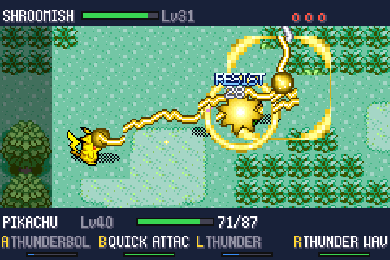
  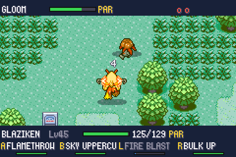
</p>

> **Aviso legal.** Este repositório **não contém nenhuma ROM**. Pokémon é marca e propriedade da Nintendo / Game Freak / Creatures. Os gráficos dos Pokémon em batalha vêm do [PMD SpriteCollab](https://sprites.pmdcollab.org) (licença **CC BY-NC 4.0**). Projeto pessoal, sem fins comerciais. Não distribua ROMs geradas a partir dele.

---

## Índice

- [Recursos](#recursos)
- [Prints](#prints)
- [Como obter a ROM final](#como-obter-a-rom-final)
- [Controles](#controles)
- [Como foi implementado](#como-foi-implementado)
- [Ferramentas de desenvolvimento](#ferramentas-de-desenvolvimento)
- [Limitações conhecidas](#limitações-conhecidas)
- [Créditos e licenças](#créditos-e-licenças)

---

## Recursos

- **Combate em tempo real** em todas as batalhas suportadas: selvagens, treinadores, duplas (2×2, com aliado controlado por IA), batalhas com parceiro (Steven), Safari Zone, Battle Frontier e Battle Pyramid.
- **Arena = o lugar onde a batalha começou.** A arena é recortada do mapa real ao redor do jogador (árvores, prédios, cavernas, água, animações de tileset). Dentro dela, um **campo de luta de tamanho fixo (18×10 metatiles)** é a área de luta: ele vai para onde há menos obstáculos, e tudo dentro dele vira chão sem colisão (pedras, placas, árvores, paredes, ledges e degraus são pintados com o chão em volta). Uma moldura com as árvores/rochas de borda do mapa fecha o campo, e o cenário ao redor aparece escurecido — o que está claro é onde dá para andar, o que está escuro não.
- **Objetos na arena:** pedras de Rock Smash, árvores de Cut, rochas de Strength e caixas de mudança — os próprios sprites do overworld do Emerald, escolhidos conforme o lugar (caixas em lugares fechados, pedras em cavernas, árvores e pedras em rotas). Eles bloqueiam passagem e tiros, quebram quando atingidos, e **golpes como Psychic, Confusion, Extrasensory, Seismic Toss, Strength, Vital Throw, Rock Throw e Ancient Power levantam um objeto próximo e o arremessam** no adversário.
- **Todos os 386 Pokémon obtíveis:** Pokémon de Kanto e Johto (e os de Hoenn que só vinham de troca, evento ou escolha única) foram espalhados pelas rotas, cavernas e águas do Emerald, em lugares coerentes com o tipo e o nível ([lista](docs/POKEMON_LOCAIS.md)). Evoluções por troca viraram por nível/item, e os itens de evolução são vendidos em Lilycove.
- **Lendários:** os pássaros de Kanto, os cães de Johto, Ho-Oh, Latias e Latios andam livres desde o início do jogo e podem aparecer em qualquer encontro; Lugia só no mar. Depois do Hall da Fama aparecem Celebi, Jirachi e Mewtwo em lugares temáticos, e os tickets de evento (Deoxys, Mew, Lugia/Ho-Oh, Latias/Latios) são entregues automaticamente.
- **Os 354 golpes da 3ª geração** têm comportamento, animação e efeitos próprios: projéteis, raios, ondas em cone, golpes corpo a corpo, áreas, zonas persistentes, ataques que caem do céu, Fly/Dig/Dive, clima e mais.
- **Mira e esquiva:** tocar o botão dispara para a frente (com uma leve mira automática), segurar abre uma mira girável; SELECT faz um dash com quadros de invencibilidade.
- **Cooldown no lugar de PP:** golpe com pouco PP no jogo original tem cooldown longo. PP Up / PP Max reduzem o cooldown, e a tela de resumo mostra o tempo em segundos.
- **Fôlego pós-batalha:** ao vencer (ou capturar), cada Pokémon do time que lutou recupera 30% do HP máximo — inclusive os que desmaiaram, que voltam a ficar de pé.
- **Regras originais preservadas:** fórmula de dano da 3ª geração, tipos, STAB, críticos, habilidades, itens segurados, berries, status, estágios de atributo, clima, experiência (Exp. Share, Lucky Egg, Pokémon trocados), dinheiro, Pay Day, Pickup, captura (fórmula original com multiplicadores de cada Poké Ball), apelido, aprender golpes e evolução.
- **IA** com nível de habilidade por classe de treinador: escolhe alvos e golpes, mantém distância ideal, desvia de projéteis, contorna obstáculos (pathfinding em grade) e usa itens (Potions, X Items…).
- **Sprites animados** de todos os 386 Pokémon (andar, parado, ataque, disparo, dano, dormir, carregar), em 8 direções, com paletas shiny.
- **HUD e menus em tempo real**: barras de HP, barras de cooldown, menu de pausa (LUTAR / BOLSA / POKéMON / FUGIR), bolsa, troca de Pokémon, mensagens.

## Prints

| | |
|---|---|
| 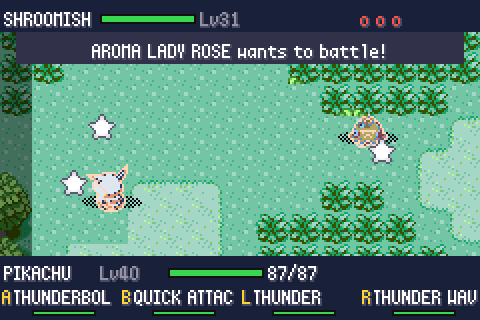 Início de batalha contra treinador |  Thunderbolt (com "RESIST" e número de dano) |
| 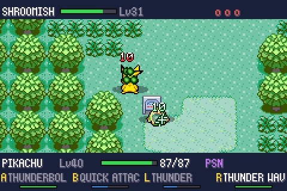 Thunder: marcador no chão antes do raio cair; status PAR/PSN |  Flamethrower do Blaziken |
| 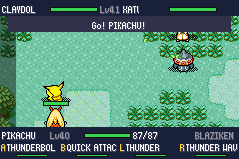 Batalha dupla (Tate & Liza), aliado com barra de HP | 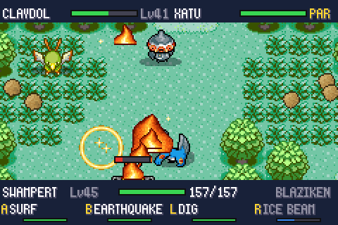 Batalha dupla: Sunny Day e Flamethrower |
| 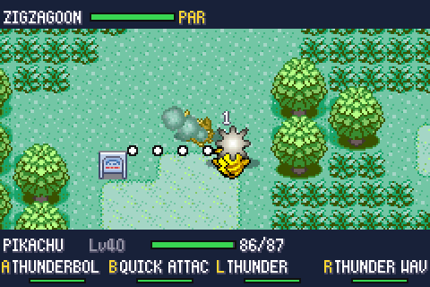 Mira manual (segurando o botão do golpe) | 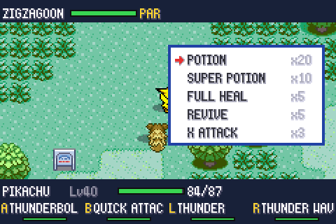 Bolsa durante a batalha |
| 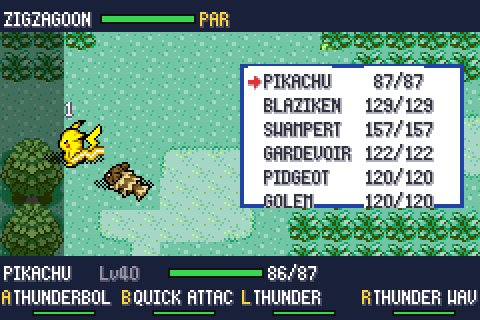 Escolha do alvo do item | 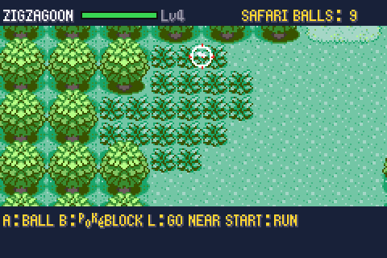 Safari Zone |
| 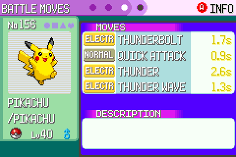 Cooldown em segundos no resumo | |

**Objeto arremessado com Psychic** (a pedra é levantada, flutua sobre o Pikachu e é lançada no Snorlax)

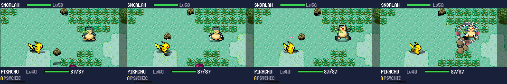

**Lendário andando livre** (Zapdos encontrado na Route 101)

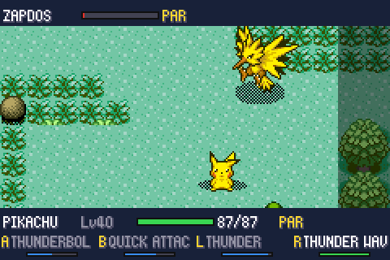

**Quadros de animação** (Thunderbolt, Thunder, Earthquake, Shadow Ball): carga de energia, disparo, rastro e impacto

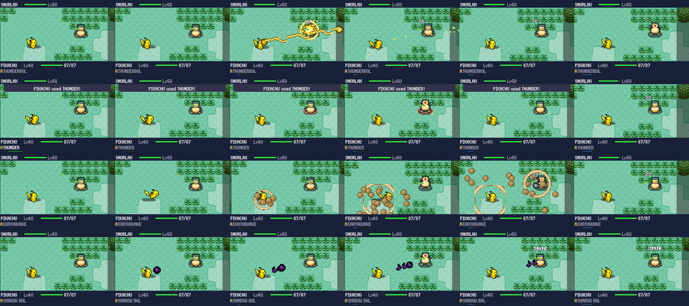

**Surf: a onda sai estreita e se abre em cone**

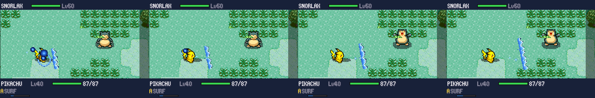

**Alguns dos 354 golpes** (Fire Punch, Wing Attack, Tackle, Ember, Flamethrower, Hydro Pump, Surf, Ice Beam, Blizzard, Hyper Beam, Solarbeam, Thunderbolt, Thunder, Earthquake, Psychic, Fire Blast, Explosion, Rock Slide, Sludge Bomb, Outrage, Shadow Ball, Fake Out, Weather Ball, Psycho Boost)

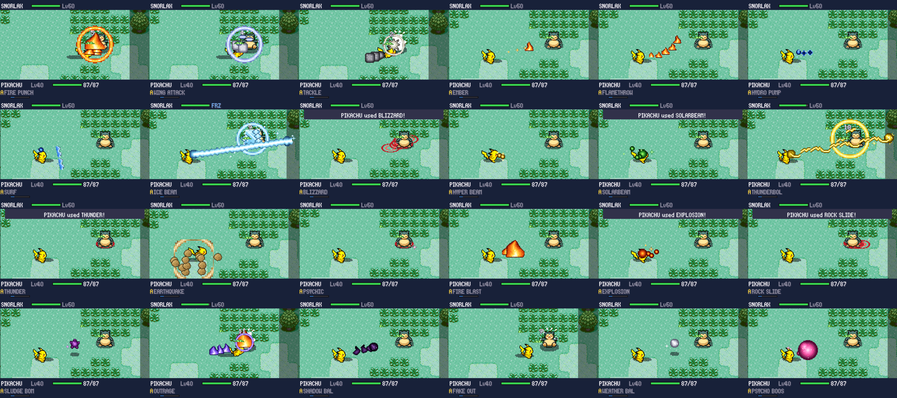

**Arenas geradas a partir do mapa** (o campo claro é a área de luta; o cenário escurecido em volta não é caminhável) — Route 101, Petalburg Woods, ginásio de Rustboro, Meteor Falls, Slateport, Route 113 (cinzas), Route 119, Mt. Pyre (exterior), Dewford, Abandoned Ship, Jagged Pass e ginásio de Fortree:

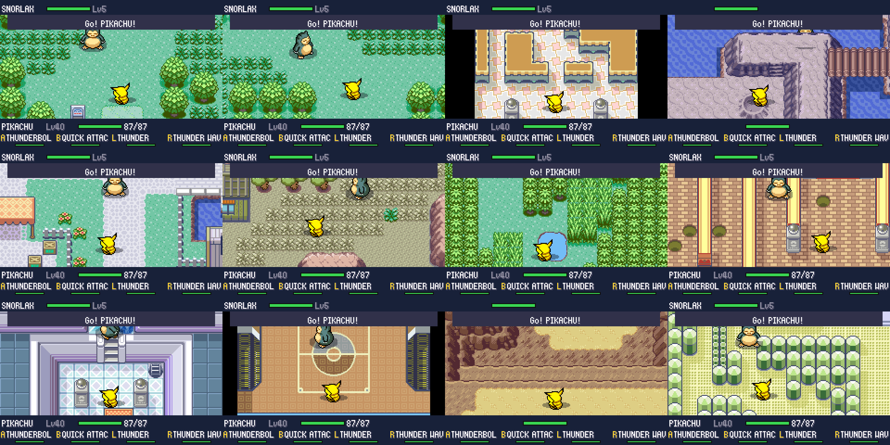

Arena inteira (512×256 px), com o campo de luta em destaque e a moldura de borda, gerada para Route 101, Dewford, Petalburg, Route 113, Meteor Falls e Mt. Pyre:

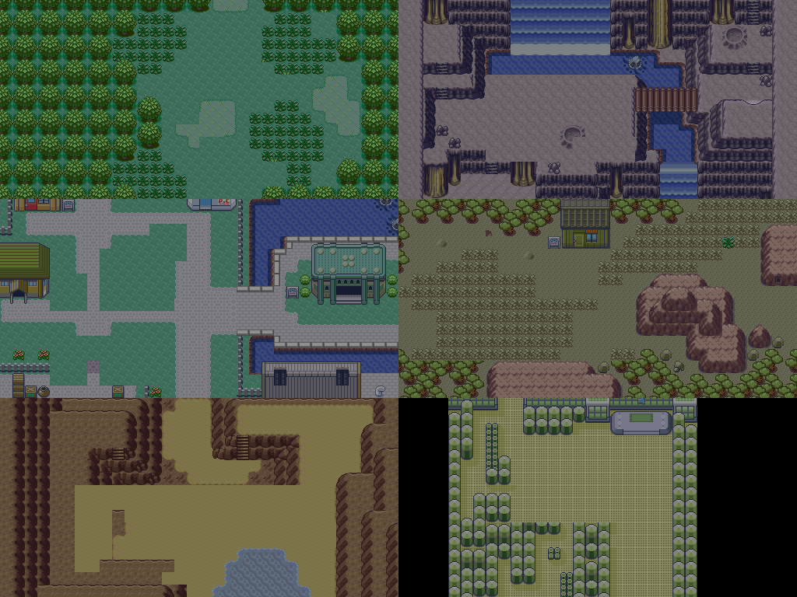

---

## Como obter a ROM final

O projeto compila uma ROM completa a partir do código-fonte e dos assets da decompilação. **Não é preciso uma ROM original para compilar** — mas você deve possuir o jogo original para jogar legalmente.

### 1. Instale as dependências

Linux (Ubuntu/Debian) ou Windows via **WSL** (Ubuntu):

```bash
sudo apt update
sudo apt install build-essential git libpng-dev \
                 gcc-arm-none-eabi binutils-arm-none-eabi libnewlib-arm-none-eabi
```

> Testado com `gcc-arm-none-eabi 13.2` no Ubuntu 24.04. No macOS ou com devkitARM, siga as instruções originais em [`INSTALL.md`](INSTALL.md); o alvo de compilação usado aqui é o `modern`.

### 2. Clone e compile

```bash
git clone https://github.com/cnmoro/pokemon-emerald-realtime-battles.git
cd pokemon-emerald-realtime-battles
make modern -j$(nproc)
```

A primeira compilação também compila as ferramentas auxiliares do pret (`gbagfx`, `scaninc`, `preproc`…) e leva alguns minutos.

### 3. Pegue a ROM

O resultado é **`pokeemerald_modern.gba`** na raiz do repositório. A compilação é reprodutível (mesmo código → mesma ROM, byte a byte). Abra no emulador (recomendado: **[mGBA](https://mgba.io)**; o save Flash 128K é detectado automaticamente).

Opcional: a ROM sai com 32 MB por causa do preenchimento final. Para reduzir para ~17 MB (cabe em mais flashcarts e transfere mais rápido), corte o preenchimento:

```bash
python3 - <<'EOF'
d = open('pokeemerald_modern.gba', 'rb').read()
n = len(d)
while n and d[n-1] in (0x00, 0xFF): n -= 1
n = (n + 0xFFFF) & ~0xFFFF
open('pokeemerald_rt.gba', 'wb').write(d[:n])
EOF
```

> Os assets gerados do mod (sprites comprimidos, atlas de efeitos, tabelas de golpes) já estão versionados em `graphics/rt/`, `src/data/rt/` e `include/rt_fx_ids.h`, então **não é preciso** baixar o SpriteCollab para compilar. Para regerá-los veja [Ferramentas de desenvolvimento](#ferramentas-de-desenvolvimento).

---

## Controles

| Botão | Ação |
|---|---|
| Direcional | Mover |
| **A / B / L / R** | Golpes 1 / 2 / 3 / 4. **Toque**: dispara na direção em que o Pokémon está virado (com auto-mira leve no inimigo). **Segurar**: aparece a mira; gire com o direcional e solte para disparar |
| **SELECT** | Dash / esquiva (invencível por alguns quadros; tem cooldown) |
| **START** | Pausa: LUTAR / BOLSA / POKéMON / FUGIR |

- **Captura:** na BOLSA escolha uma Poké Ball; o botão A vira "lançar bola" — mire e acerte o Pokémon.
- **Safari:** A lança bola, B lança Pokébloco, L chega mais perto, START/R foge.
- **Batalha dupla:** você controla o primeiro Pokémon; o segundo é um aliado com IA. Se o seu cair e não houver reservas, você assume o aliado.
- Dica: no emulador, mapeie SELECT para uma tecla confortável (Shift/Espaço).

---

## Como foi implementado

### Visão geral

O motor de batalha original continua no ROM, mas `CB2_InitBattle` (em `src/battle_main.c`) desvia para o novo motor sempre que o tipo de batalha é suportado (`RtBattle_IsSupported`). O motor em tempo real prepara as equipes, roda a luta inteira com seus próprios callbacks e, no fim, devolve o controle ao overworld exatamente como `ReturnFromBattleToOverworld` faria (resultado da batalha, dinheiro, whiteout, evolução, Pokémon capturado etc.), então os scripts do jogo continuam funcionando sem alteração.

Todo o código novo tem o prefixo `rt_` (~12,5 mil linhas de C):

| Arquivo | Responsabilidade |
|---|---|
| `src/rt_main.c` | Ciclo de vida da batalha: setup de vídeo, VBlank, laço principal, câmera, intro/luta/desfecho, entrada do jogador (toque/segurar/mira assistida), troca e entrada de Pokémon, experiência, aprender golpes, dinheiro, captura/apelido, evolução e retorno ao overworld |
| `src/rt_arena.c` | Geração da arena a partir do mapa, carregamento de tilesets/paletas/animações, colisão, spawn e pathfinding |
| `src/rt_actor.c` | "Atores" (Pokémon em campo): física em ponto fixo, atributos e estágios, status, berries, animações e sprites, paletas (flash de dano, tons de status, shiny) |
| `src/rt_moves.c` | Golpes: cooldown, cálculo de dano da 3ª geração, padrões de execução, projéteis e hitboxes, efeitos secundários, habilidades, clima, efeitos de campo |
| `src/rt_fx.c` | Efeitos visuais: OAM em camadas, partículas, paletas dinâmicas, matrizes afins, números de dano, textos ("SUPER!", "RESIST"), tremor/flash de tela, clima |
| `src/rt_ai.c` | IA: escolha de alvo e golpe, distância preferida, esquiva, mira com antecipação, pathfinding, uso de itens por treinadores |
| `src/rt_ui.c` | HUD, mensagens, menus (pausa, bolsa, equipe, aprender golpe, sim/não), uso de itens, Poké Balls, Safari |
| `src/rt_debug.c` | Modo de depuração (desativado na ROM final) usado nos testes automatizados |
| `src/data/rt/*.h`, `graphics/rt/*.bin` | Dados gerados: frames dos sprites, paletas, atlas de efeitos, definição dos 354 golpes |

Mudanças em arquivos do jogo original (pequenas): `battle_main.c` (desvio para o motor novo), `battle_setup.c`, `battle_script_commands.c` (Pickup), `pokemon_summary_screen.c` e `menu_specialized.c` (mostrar cooldown em vez de PP), `strings.c`, e ganchos de depuração inertes em `overworld.c`, `new_game.c`, `main_menu.c`, `field_control_avatar.c`.

### Arena a partir do mapa

1. Uma grade de 80×48 metatiles ao redor do jogador é classificada em *caminhável*, *bloqueia projéteis* ou *aberta* (caminhável com os 8 vizinhos caminháveis). Se o jogador está surfando, a água vira o chão.
2. Com somas de prefixo, todas as janelas de 32×16 metatiles (512×256 px, o tamanho de um mapa de BG) são pontuadas por área aberta e proximidade do jogador; as melhores candidatas passam por uma busca em largura que mede a maior região conectada.
3. A janela vencedora é copiada como está (layers *normal/covered/split* idênticas às do overworld, com animações de tileset).
4. **Campo de luta — sempre 18×10 metatiles (288×160 px):** o retângulo é posicionado (alinhado aos blocos de borda do mapa) onde menos coisa precisa ser limpa: cada célula que não é chão limpo do nível do jogador custa, e o vazio fora de uma sala custa mais. Dentro dele tudo vira chão: o que não é chão limpo é agrupado em objetos (8-conectados) e cada objeto é pintado com o chão que mais aparece em volta dele (votação de maioria), então trilhas continuam trilhas e grama continua grama; objetos pequenos que encostam no campo são apagados inteiros; degraus, crateras e peças raras também somem; em interiores o piso fica uniforme.
   - **Moldura:** em volta do campo, onde algum objeto cortado pela borda apareceria (meio prédio, meio penhasco), é desenhado um anel de 2 metatiles com os *blocos de borda* do próprio mapa — as árvores das rotas e cidades, a rocha das cavernas. O campo vira uma clareira em vez de um buraco recortado no cenário. Em mapas cuja borda é água ou vazio (interiores) o anel não é desenhado.
5. Fora do campo fica o cenário real, **escurecido** por hardware: a janela 0 do GBA cobre o campo (atualizada a cada quadro com o scroll da câmera) e o efeito de escurecimento (`BLDCNT`/`BLDY`) só vale fora dela. Assim fica óbvio onde dá e onde não dá para andar.
6. Os pontos de spawn ficam dentro do campo, na diagonal (jogador embaixo à esquerda, inimigo em cima à direita), porque a tela é larga e baixa; a câmera enquadra os dois.

### Objetos da arena (`src/rt_props.c`)

- Até 6 objetos por arena, sorteados dentro do campo de luta, longe dos pontos de spawn e entre si. O tipo depende do mapa: caixas em interiores/cidades, pedras e rochas em cavernas/deserto, árvores, pedras e rochas nas rotas; nada sobre a água.
- Gráficos: os sprites do overworld (`graphics/object_events/pics/misc`) com as paletas originais, incluídos no atlas de efeitos pelo `fxgen.py`. Pedra e árvore usam os quadros reais de Rock Smash / Cut quando quebram.
- Física: colisão em círculo com os atores (empurrão), bloqueiam o movimento de investidas, projéteis e linhas de visão; têm HP e piscam ao serem atingidos.
- Arremesso: quando um golpe da lista é executado e há um objeto alcançável (Psychic e parecidos: até ~110 px; golpes físicos: à frente e colado), o golpe normal é substituído: o objeto flutua até ficar acima do usuário e é lançado como projétil do próprio golpe, mirando o alvo — o dano é o do golpe (incluindo efeitos secundários), e o objeto se despedaça no impacto.

### Pokédex completa (`tools/rt/dexplan.py`)

O script lê `species_info.h`, `evolution.h` e `wild_encounters.json`, calcula o que já é obtível (natureza, presentes, estáticos, evolução e reprodução) e, para cada família que falta, troca alguns slots de encontro por ela. A escolha pontua cada slot pela afinidade de tipo com o Pokémon que estava ali (Caterpie/Weedle onde há Wurmple, Pikachu onde há Electrike…), pelo habitat (grama, caverna, surf, pesca, Rock Smash), pelo poder (BST) e pelo nível da área, sem tirar espécies originais de onde elas são raras. Alguns casos são posicionados à mão (Porygon em New Mauville, Unown em ruínas, fósseis de Kanto no mar, iniciais de Kanto/Johto/Hoenn em lugares temáticos…).

### Lendários (`src/rt_legends.c`)

- Encaixado em `TryStartRoamerEncounter()`: em ~1/48 dos encontros selvagens surge um lendário ainda não capturado (Lugia só surfando em rotas oceânicas). O dano que ele leva é guardado em variáveis não usadas do save, e ele foge depois de alguns segundos, como os roamers originais. O roamer único do Emerald pós-jogo foi desativado.
- Depois do Hall da Fama: Celebi, Jirachi e Mewtwo com 1/12 de chance nos encontros de Petalburg Woods, Meteor Falls e Victory Road; e os quatro tickets de evento (Aurora Ticket, Old Sea Map, Mystic Ticket, Eon Ticket) são colocados na bolsa com as rotas de barco liberadas.

### Combate

- **Posições em ponto fixo Q8**, ângulos de 0–255, colisão círculo-contra-grade com preservação de sub-pixel.
- **Cooldown** = `1560 / PP máximo` quadros, limitado a 0,5–5,5 s (PP Ups contam).
- **Dano**: fórmula da 3ª geração completa (nível, Atk/Def ou SpA/SpD, estágios, STAB, tipos, crítico, clima, habilidades, itens), aplicada quando a hitbox encosta no alvo. Cada acerto tira exatamente o mesmo que no jogo original (sem escala extra).
- **Padrões de golpe** (cada um dos 354 golpes tem uma especificação em `src/data/rt/move_defs.h` com padrão, forma do efeito, paleta, velocidade, alcance, raio, quantidade, dispersão, tempos, impacto e som):

  | Padrão | Golpes | Exemplos |
  |---|---|---|
  | `BULLET` — projéteis (retos, em arco, teleguiados, bumerangue) | 81 | Ember, Shadow Ball, Sludge Bomb |
  | `MELEE` — arco à frente, sincronizado com o quadro de impacto da animação | 75 | Fire Punch, Slash |
  | `SELF` — buffs, curas, barreiras | 69 | Swords Dance, Recover, Protect |
  | `RUSH` — investida | 30 | Tackle, Quick Attack |
  | `CONE` — cone instantâneo à frente | 19 | Leer, Growl, Sand-Attack, Roar |
  | `ZONE` — nuvem/área persistente no ponto mirado | 13 | Spore, Poison Powder, Fire Spin |
  | `WAVE` — onda que avança e se abre em cone | 12 | Surf, Heat Wave, Hyper Voice |
  | `BEAM` — raio contínuo, cortado por obstáculos | 11 | Ice Beam, Thunderbolt, Hyper Beam |
  | `BURST` — explosão ao redor do usuário | 10 | Earthquake, Explosion, Magnitude |
  | `TARGETED` — impacto no ponto mirado após aviso no chão | 10 | Thunder, Blizzard, Rock Slide, Future Sight |
  | `FIELD` — efeito no campo inteiro | 10 | Rain Dance, Sandstorm, Haze |
  | `STREAM` — jato contínuo | 7 | Flamethrower, Hydro Pump, Water Gun |
  | `LEAP` / `BURROW` / `ROLL` | 7 | Fly, Bounce, Dig, Dive, Rollout |

- **Efeitos especiais da 3ª geração** foram adaptados ao tempo real: Protect/Detect (janela de bloqueio), Counter/Mirror Coat (janela de reação), Substitute, Future Sight/Doom Desire (marcador no chão), Baton Pass, Roar/Whirlwind (encerram batalhas selvagens), Encore/Disable/Taunt/Torment/Imprison, Truant, Intimidate, Trace, Forecast, clima vindo do overworld etc.
- **Aliados e inimigos** em batalhas duplas são atores comuns com IA; golpes de área atingem todos que estiverem na área, como no original.

### Gráficos

- **Sprites**: os sprites do PMD SpriteCollab (animações Walk/Idle/Attack/Shoot/Hurt/Sleep/Charge, 5 direções + espelhamento) foram quantizados para 15 cores, recortados em formatos de OAM válidos, deduplicados e comprimidos em LZ77 (~3,8 MB para os 386 Pokémon). O quadro de impacto de cada animação de ataque é guardado para sincronizar a hitbox corpo a corpo. Paletas shiny são derivadas mapeando a paleta normal→shiny dos sprites originais do Emerald.
- **Efeitos**: um atlas procedural (81 formas, 34 paletas) gerado por script: chamas, raios, gotas, folhas, rochas, cristais, notas, anéis, feixes, ondas, números, palavras…
- **VRAM**: tileset do mapa no charblock 0 (igual ao overworld, para as animações funcionarem), três camadas de mapa 512×256 nos BG1–3, HUD no BG0; OBJ: 4 slots de 64 tiles para os atores, barras de UI, atlas de efeitos; paletas OBJ 5–15 alocadas dinamicamente (LRU) para efeitos.
- **Efeitos dos golpes** (por cima dos padrões):
  - golpes com tempo de preparação mostram energia **convergindo** para o usuário (partículas que vêm de fora para dentro, brilho que cresce e anel no chão);
  - golpes de status/buff em si mesmo têm aura: anel que se expande no chão, o emblema do golpe (escudo, espada, aura…) crescendo sobre o Pokémon e partículas subindo em coluna;
  - projéteis deixam um rastro de faíscas na cor do golpe, e os pequenos são desenhados maiores (matriz afim);
  - jatos (Flamethrower, Hydro Pump…) começam pequenos e crescem enquanto avançam;
  - raios soltam faíscas ao longo do feixe e na ponta;
  - golpes que caem do céu (Thunder, Blizzard, Rock Slide…) acumulam energia sobre o marcador no chão antes de cair; o Thunder é um raio de 4 segmentos com anel de choque;
  - todo impacto gera uma onda de choque em anel, além das partículas do tipo.
- **Sombras** em xadrez (dither) em vez de transparência por hardware, que agora fica reservada para escurecer o cenário fora do campo.

### Desempenho

O GBA tem 228 linhas de varredura por quadro e o áudio (m4a) já consome ~50 delas. Para manter 60 fps:

- **Medição** com `REG_VCOUNT` por etapa do quadro (perfilador embutido no modo debug) e média/pior caso por etapa.
- **HUD incremental**: cada texto do HUD é um elemento com uma "chave"; só é redesenhado quando a chave muda, no máximo **um texto por quadro**, e só se ainda houver tempo no quadro.
- Barras de HP/cooldown geradas por palavras de 32 bits em vez de pixel a pixel.
- **Orçamento de descompressão**: no máximo 2 quadros de sprite descomprimidos por quadro de jogo.
- **Descarte de partículas** quando o quadro está atrasado (apenas efeitos cosméticos).
- Pathfinding com campos de distância em cache (reaproveitados enquanto o alvo não sai da célula) e linhas de visão baratas.
- Buffers grandes em EWRAM: a pilha da IWRAM tem só ~2 KB.

Resultado: ~95–97 % dos quadros em batalhas duplas carregadas; batalhas simples praticamente a 60 fps.

### Testes

Toda a validação foi automatizada com um **runner headless do mGBA** (`tools/rt_harness`) que executa scripts (esperar, apertar botões, ler/escrever memória, salvar prints, despejar VRAM):

- **Regressão de todos os golpes**: cada um dos 354 golpes é usado numa batalha contra um Snorlax, com 3 prints por golpe e checagem de que a batalha volta ao overworld.
- Batalhas automáticas (o jogador também controlado por IA) contra treinadores, duplas, Safari, captura, evolução, troca de Pokémon, whiteout.
- Renderização da arena inteira a partir de um dump da VRAM, para inspecionar a geração em 12 mapas diferentes.
- Perfil de desempenho por etapa do quadro.

---

## Ferramentas de desenvolvimento

### Regerar os assets (`tools/rt`)

| Script | Gera |
|---|---|
| `sprites.py INICIO FIM saida.pkl` | Processa os sprites do SpriteCollab (dex `INICIO..FIM`) |
| `build_sprites.py` | `graphics/rt/sprites.bin` + `src/data/rt/species_gfx.h` |
| `fxgen.py` | `graphics/rt/fx_atlas.bin`, `include/rt_fx_ids.h`, `src/data/rt/fx_data.h` |
| `movelist.py` → `movegen.py` | `src/data/rt/move_defs.h` (especificação de cada golpe) |
| `dexplan.py [--apply]` | Distribui os Pokémon que faltam em `src/data/wild_encounters.json` (já aplicado; rodar de novo não é necessário) |
| `lzc.c` | Compressor LZ77 em lote usado pelo `build_sprites.py` |

```bash
pip install pillow numpy
git clone https://github.com/PMDCollab/SpriteCollab.git    # grande
export SPRITECOLLAB=$PWD/SpriteCollab
cd tools/rt
gcc -O2 lzc.c -o lzc
python3 sprites.py 1 193   ../../build/rt_work/a.pkl
python3 sprites.py 194 386 ../../build/rt_work/b.pkl
python3 build_sprites.py
python3 fxgen.py
python3 movelist.py && python3 movegen.py
```

### Runner headless (`tools/rt_harness`)

Usado para testes e prints. Requer o mGBA compilado como biblioteca estática (`libmgba.a`, testado com mGBA 0.11-dev). Veja [`tools/rt_harness/README.md`](tools/rt_harness/README.md).

---

## Limitações conhecidas

- Continuam no sistema por turnos original: batalhas por cabo/link, gravações (Battle Frontier recorded battles), e-Reader e o tutorial do Wally.
- Com Repel ativo, os lendários errantes também não aparecem.
- Em salas internas mais estreitas que a tela aparecem faixas pretas nas laterais (como no overworld).
- Objetos do mapa que não são metatiles (NPCs, árvores cortáveis, pedras de Rock Smash) não aparecem na arena.
- O campo de luta é sempre um retângulo de 18×10; em salas menores que isso ele passa por cima das paredes e do vazio em volta da sala.
- Balanceamento (ritmo de dano, cooldowns) foi ajustado por testes, mas é subjetivo; o multiplicador global fica em `RT_DMG_SCALE` (`src/rt_moves.c`).

## Créditos e licenças

- **[pret/pokeemerald](https://github.com/pret/pokeemerald)** — a decompilação sobre a qual este mod foi feito. README original em [`docs/README_pokeemerald.md`](docs/README_pokeemerald.md).
- **[PMD SpriteCollab](https://sprites.pmdcollab.org)** — sprites animados dos Pokémon usados nas batalhas, licenciados sob **CC BY-NC 4.0**. Todos os créditos aos artistas do projeto (lista completa em `credit_names.txt` do repositório do SpriteCollab). Os dados derivados em `graphics/rt/sprites.bin` herdam essa licença: uso não comercial, com atribuição.
- **[mGBA](https://mgba.io)** — usado como biblioteca no runner de testes.
- Pokémon © Nintendo / Creatures Inc. / GAME FREAK inc. Projeto de fã, sem fins lucrativos e sem afiliação.

Código do mod desenvolvido com o Claude (Anthropic).
