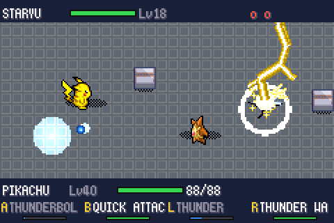
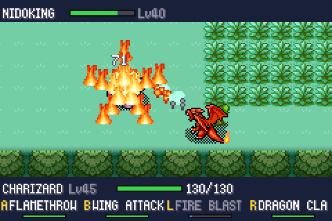
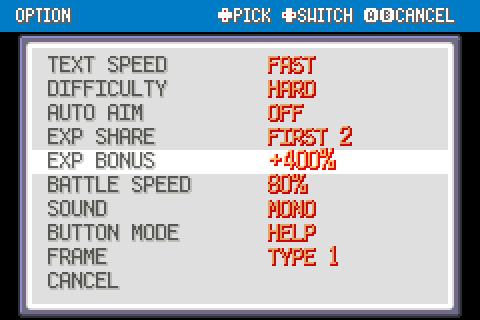
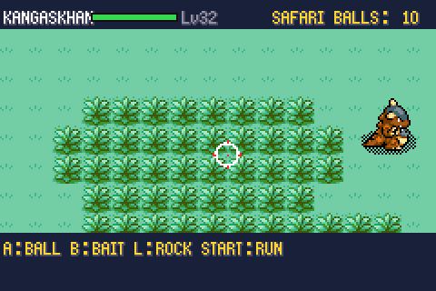
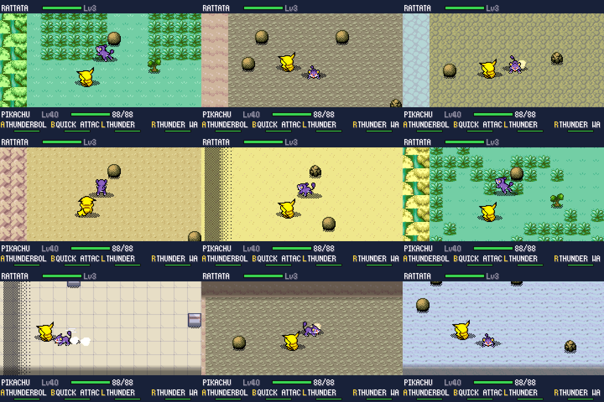

# Pokémon FireRed — Batalhas em Tempo Real

Um mod de **Pokémon FireRed** (feito sobre a decompilação [pret/pokefirered](https://github.com/pret/pokefirered)) que troca o sistema de batalha por turnos por **combate em tempo real numa arena**. É a versão Kanto do mod [Pokémon Emerald — Batalhas em Tempo Real](https://github.com/cnmoro/pokemon-emerald-realtime-battles) (branch `main` deste mesmo repositório): o motor de batalha é o mesmo código, compartilhado por uma camada de compatibilidade. A ROM continua 100% GBA: roda em qualquer emulador ou flashcart.

Selvagens, treinadores, líderes de ginásio, Elite Four, rival, batalhas duplas e Safari Zone viram ação: você anda pela arena, mira os golpes, desvia com um dash, e cada golpe tem animação, hitbox e cooldown próprios.

<p align="center">
  
  
</p>

> **Aviso legal.** Este repositório **não contém nenhuma ROM**. Pokémon é marca e propriedade da Nintendo / Game Freak / Creatures. Os gráficos dos Pokémon em batalha vêm do [PMD SpriteCollab](https://sprites.pmdcollab.org) (licença **CC BY-NC 4.0**). Projeto pessoal, sem fins comerciais. Não distribua ROMs geradas a partir dele.

---

## Índice

- [Recursos](#recursos)
- [O que muda em relação à versão Emerald](#o-que-muda-em-relação-à-versão-emerald)
- [Prints](#prints)
- [Como obter a ROM final](#como-obter-a-rom-final)
- [Controles](#controles)
- [Como foi implementado](#como-foi-implementado)
- [Limitações conhecidas](#limitações-conhecidas)
- [Créditos e licenças](#créditos-e-licenças)

---

## Recursos

Tudo o que a versão Emerald tem e que faz sentido em Kanto foi portado:

- **Combate em tempo real** em selvagens, treinadores, ginásios, Elite Four, campeão, rival, batalhas duplas (2×2, com aliado controlado por IA) e Safari Zone.
- **Arena = o lugar onde a batalha começou.** A arena é recortada do mapa real ao redor do jogador (árvores, prédios, cavernas, água, animações de tileset). Um **campo de luta fixo de 18×10 metatiles** vai para onde há menos obstáculos; tudo dentro dele vira chão sem colisão, e o cenário em volta aparece escurecido — o que está claro é onde dá para andar. Em Kanto o campo usa **um único chão** (mais a grama alta, se houver): as peças de transição trilha/grama do FireRed não viram mais uma colcha de retalhos.
- **Objetos na arena:** pedras de Rock Smash, árvores de Cut e rochas de Strength — os próprios sprites do overworld do FireRed — bloqueiam passagem e tiros, quebram quando atingidos, e **Psychic, Confusion, Seismic Toss, Strength, Rock Throw, Ancient Power** etc. levantam um objeto e o arremessam. Nunca aparecem sobre a água.
- **Os 354 golpes da 3ª geração** com comportamento, animação e efeitos próprios: projéteis, raios, ondas em cone, corpo a corpo, áreas, zonas persistentes, ataques que caem do céu, Fly/Dig/Dive, clima e mais.
- **Mira e esquiva:** tocar o botão dispara para a frente (com leve mira automática), segurar abre uma mira girável; SELECT faz um dash com quadros de invencibilidade.
- **Cooldown no lugar de PP:** golpe com pouco PP tem cooldown longo; PP Up / PP Max reduzem o cooldown, e o resumo do Pokémon mostra o tempo em segundos.
- **Equilíbrio corpo a corpo × distância:** avanço automático dos golpes corpo a corpo até o alvo próximo, alcance mínimo global, armadura de contato (−20% de dano, sem empurrão), rebater projéteis numa janela curta (só se o golpe corpo a corpo for mais forte), perda de dano dos projéteis na distância e esquiva mais longa para atacantes físicos.
- **Itens segurados em tempo real:** um "turno" = 2,5 s. Leftovers recupera 1/16 do HP por turno; berries e ervas reagem na hora; Leppa recarrega os golpes; Focus Band avisa quando segura.
- **Golpes que funcionam num estado:** dormindo, **Snore** e **Sleep Talk** funcionam; congelado, **Flame Wheel** e **Sacred Fire** descongelam.
- **IA** com nível por classe de treinador: escolhe alvo e golpe, mantém distância, desvia, contorna obstáculos e usa itens (Potions, X Items…).
- **Sprites animados** (andar, parado, ataque, disparo, dano, dormir, carregar) em 8 direções, com paletas shiny; HUD, menu de pausa (LUTAR / BOLSA / POKéMON / FUGIR), bolsa, troca de Pokémon e mensagens em tempo real.
- **Captura mais fácil:** chance da fórmula original +10%, mínimo de 2% por lançamento, e **+1%** a cada bola que acerta e o Pokémon escapa na mesma batalha. A bola faz uma leve curva em direção ao alvo. **POKé BALL infinita:** sempre sobra pelo menos uma POKé BALL comum, que não é gasta.
- **Tempo para capturar:** selvagens só fogem com Teleport/Roar/Whirlwind depois de 8 s, e os lendários errantes fogem depois de ~8–10 s.
- **Painel de EXP no fim da batalha**, com as barras enchendo e as subidas de nível; segurar **A** acelera o desfecho.
- **Aprender golpe com 4 golpes:** a caixa espera soltar os botões antes de aceitar a escolha, e esquecer/desistir pede confirmação (NÃO pré-selecionado) — nada é sobrescrito com um clique só.
- **Fôlego pós-batalha:** ao vencer ou capturar, cada Pokémon que lutou recupera 30% do HP máximo (desmaiados voltam de pé).
- **Regras originais preservadas:** fórmula de dano da 3ª geração, tipos, STAB, críticos, habilidades, itens, status, estágios, clima, experiência, dinheiro, Pay Day, Pickup, captura, apelido, aprender golpes e evolução.

### Menu OPTION

O menu de opções do FireRed ganhou cinco linhas (dez no total, o título "OPTION" foi para a barra de cima):

| Opção | Valores | Efeito |
|---|---|---|
| **DIFFICULTY** | EASY / MEDIUM / HARD | Esperteza da IA: reação, pontaria (inclusive mirar à frente), dash, escolha de golpes, ritmo e velocidade dos projéteis inimigos. Ocupa a linha BATTLE SCENE. |
| **AUTO AIM** | ON / OFF | Ligado, o golpe sai na hora mirando o inimigo mais próximo. Ocupa a linha BATTLE STYLE. |
| **EXP SHARE** | OFF / FIRST 2 … FIRST 5 / ALL 6 | Divide a EXP entre os N primeiros do time, sem precisar do item. |
| **EXP BONUS** | OFF / +25% … +400% | Multiplica a EXP de toda vitória. |
| **BATTLE SPEED** | 60% … 100% | Ritmo de toda a luta (movimento, golpes, recargas, animações); 100% é o ritmo original, 80% é o padrão. |

### Pokédex de Kanto e Johto

- **Todos os 251 Pokémon da 1ª e 2ª geração obtíveis**, espalhados pelas rotas, cavernas e águas de Kanto e das Sevii Islands em lugares coerentes com tipo e nível ([lista](docs/POKEMON_LOCAIS.md)).
- **Encontros equilibrados:** em cada grama/água/rocha/vara, toda espécie da área tem a mesma chance.
- **Sem evolução por troca:** Kadabra, Machoke, Graveler e Haunter evoluem por nível; Onix/Scyther com Metal Coat, Seadra com Dragon Scale, Porygon com Up-Grade, Poliwhirl/Slowpoke com King's Rock — usados na bolsa como pedra de evolução. Espeon e Umbreon evoluem com Sun Stone e Moon Stone. Os itens de evolução são vendidos em Celadon.
- **MOVES no menu do Pokémon:** reensina de graça os golpes por nível até o nível atual, mais os egg moves da família.
- **HMs sem "HM slave":** ter a HM na bolsa (e a insígnia) basta para Cut, Rock Smash, Strength, Surf e Waterfall; cavernas escuras acendem sozinhas com a HM05. FLY continua precisando de um Pokémon que conheça o golpe.

### Lendários de Kanto

- **Raikou, Entei e Suicune** andam livres por Kanto (nível 35) e podem surgir em qualquer encontro em terra; o dano que levam é guardado entre encontros.
- Os lendários fixos do FireRed (Articuno, Zapdos, Moltres, Snorlax, Mewtwo) são batalhas em tempo real nos lugares originais.
- **Depois do Hall da Fama:** Celebi aparece na Viridian Forest e Mew na Pokémon Mansion, e o **Mystic Ticket** e o **Aurora Ticket** são entregues automaticamente (Navel Rock: Lugia e Ho-Oh; Birth Island: Deoxys).

## O que muda em relação à versão Emerald

- **Sem Pokémon da 3ª geração na natureza** — o jogo é Kanto; a Pokédex alvo são os 251 de Kanto e Johto.
- **Safari Zone:** em vez de Pokébloco e "chegar mais perto", **B joga ISCA** (BAIT: menos chance de fugir e de captura) e **L joga PEDRA** (ROCK: mais chance de captura e de fuga), como no FireRed original.
- **Botões L/R:** o sistema de ajuda do FireRed (que usa L/R) é desligado durante as batalhas em tempo real, porque L e R são botões de golpe.
- **Ghost da Pokémon Tower:** o Marowak fantasma não pode ser capturado; sem o Silph Scope a batalha continua a original (por turnos).
- **Rival:** usa o nome que você deu a ele.
- **Continuam por turnos:** o tutorial do velho em Viridian, as batalhas de demonstração do Pokédude, Trainer Tower e Battle Tower (Sevii) e batalhas por cabo/wireless.

## Prints

| | |
|---|---|
|  Treinador |  Selvagem |
|  Menu OPTION |  Safari Zone (ISCA / PEDRA) |

**Arenas geradas a partir dos mapas de Kanto:**



---

## Como obter a ROM final

O projeto compila uma ROM completa a partir do código-fonte e dos assets da decompilação. **Não é preciso uma ROM original para compilar** — mas você deve possuir o jogo original para jogar legalmente.

### 1. Instale as dependências

Linux (Ubuntu/Debian) ou Windows via **WSL** (Ubuntu):

```bash
sudo apt update
sudo apt install build-essential git libpng-dev \
                 gcc-arm-none-eabi binutils-arm-none-eabi libnewlib-arm-none-eabi
```

> Testado com `gcc-arm-none-eabi 13.2` no Ubuntu 24.04. Para outros sistemas veja o [`INSTALL.md`](INSTALL.md) do pret; o alvo usado aqui é o `firered_modern`.

### 2. Clone e compile

```bash
git clone -b firered https://github.com/cnmoro/pokemon-emerald-realtime-battles.git pokemon-firered-realtime-battles
cd pokemon-firered-realtime-battles
make firered_modern -j$(nproc)
```

### 3. Pegue a ROM

O resultado é **`pokefirered_modern.gba`** na raiz do repositório. Abra no emulador (recomendado: **[mGBA](https://mgba.io)**; o save Flash 128K é detectado automaticamente).

Opcional — cortar o preenchimento final da ROM:

```bash
python3 - <<'EOF'
d = open('pokefirered_modern.gba', 'rb').read()
n = len(d)
while n and d[n-1] in (0x00, 0xFF): n -= 1
n = (n + 0xFFFF) & ~0xFFFF
open('pokefirered_rt.gba', 'wb').write(d[:n])
EOF
```

> Os assets gerados (sprites comprimidos, atlas de efeitos, tabelas de golpes) já estão versionados em `graphics/rt/`, `src/data/rt/` e `include/rt_fx_ids.h`. As ferramentas para regerá-los (`tools/rt`) são as mesmas da versão Emerald; o `fxgen.py` daqui usa os sprites de objetos do FireRed.

---

## Controles

| Botão | Ação |
|---|---|
| Direcional | Mover |
| **A / B / L / R** | Golpes 1 / 2 / 3 / 4. **Toque**: dispara para a frente (auto-mira leve). **Segurar**: aparece a mira; gire com o direcional e solte para disparar |
| **SELECT** | Dash / esquiva (invencível por alguns quadros; tem cooldown) |
| **START** | Pausa: LUTAR / BOLSA / POKéMON / FUGIR |

- **Captura:** na BOLSA escolha uma Poké Ball; o botão A vira "lançar bola".
- **Safari:** A lança bola, B lança isca, L lança pedra, START foge.
- **Batalha dupla:** você controla o primeiro Pokémon; o segundo é um aliado com IA.

---

## Como foi implementado

O motor é o mesmo da versão Emerald (veja o [README do Emerald](https://github.com/cnmoro/pokemon-emerald-realtime-battles#como-foi-implementado) para arena, golpes, gráficos, desempenho e testes). Todo o código novo tem o prefixo `rt_` e é idêntico nas duas versões, exceto por trechos `#if RT_FIRERED`.

### Camada de compatibilidade (`include/rt_compat.h`)

Mapeia os nomes do Emerald para o pokefirered:

- tipos de batalha inexistentes em Kanto (Frontier, Pyramid, Trainer Hill, dois oponentes, parceiro) viram `0`, então os ramos correspondentes somem na compilação;
- `gBattleEnvironment` → `gBattleTerrain`; funções de item, bolsa e terreno renomeadas; fontes e músicas equivalentes;
- **atributos de metatile:** o FireRed guarda 32 bits por metatile (comportamento em 9 bits, camada nos bits 29–30) e o tileset primário tem 640 metatiles e 7 paletas — `RtMetatileAttributes()` lê os atributos direto dos tilesets;
- comportamentos de metatile que só existem no Emerald apontam para um valor que nunca casa.

### Ganchos no jogo original

- `battle_main.c`: `CB2_InitBattle` desvia para o motor novo quando `RtBattle_IsSupported()` (que recusa Pokédude, Trainer Tower, Battle Tower, o tutorial e o ghost sem Silph Scope).
- `battle_setup.c`, `battle_script_commands.c` (Pickup), `pokemon_summary_screen.c` / `learn_move.c` (cooldown em vez de PP), `option_menu.c` (as cinco opções novas), `party_menu.c` (MOVES, HMs), `pokemon.c` / `evolution.h` (evoluções), `wild_encounter.c` e `roamer.c` (encontros e lendários), `help_system` desligado durante a luta.
- Memória: a EWRAM do FireRed está quase cheia, então os buffers de efeitos que no Emerald são estáticos ficam na estrutura da batalha, alocada no heap.

### Testes

O runner headless do mGBA (`tools/rt_harness`) roda os mesmos tipos de teste do Emerald, com um modo de depuração (desativado na ROM final) que pula a introdução, dá um time de teste e permite teleportar para qualquer um dos ~150 mapas com encontros/treinadores (`tools/rt/gen_debug_warps.py`). As arenas de cerca de 30 mapas de Kanto foram renderizadas e inspecionadas.

---

## Limitações conhecidas

- Continuam por turnos: batalhas por cabo/wireless, tutorial do velho, Pokédude, Trainer Tower, Battle Tower e o ghost sem Silph Scope.
- Com Repel ativo, os lendários errantes também não aparecem.
- Objetos do mapa que não são metatiles (NPCs, árvores cortáveis, pedras) não aparecem na arena.
- O campo de luta é sempre 18×10; em salas menores ele passa por cima das paredes em volta.

## Créditos e licenças

- **[pret/pokefirered](https://github.com/pret/pokefirered)** — a decompilação sobre a qual este mod foi feito. README original em [`docs/README_pokefirered.md`](docs/README_pokefirered.md).
- **[PMD SpriteCollab](https://sprites.pmdcollab.org)** — sprites animados dos Pokémon, licenciados sob **CC BY-NC 4.0**; os dados derivados em `graphics/rt/sprites.bin` herdam essa licença.
- **[mGBA](https://mgba.io)** — usado como biblioteca no runner de testes.
- Pokémon © Nintendo / Creatures Inc. / GAME FREAK inc. Projeto de fã, sem fins lucrativos e sem afiliação.

Código do mod desenvolvido com o Claude (Anthropic).
